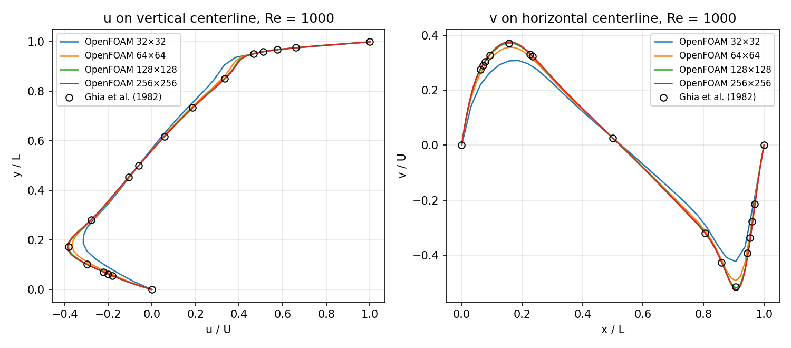
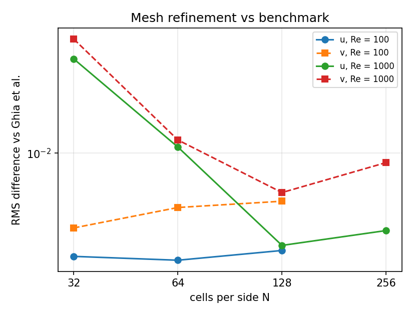
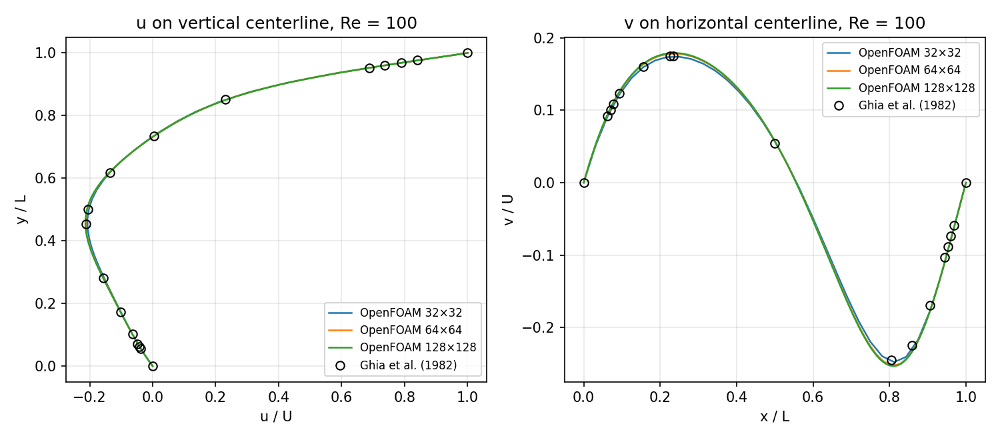

# Lid-driven cavity in OpenFOAM: verification and validation

A reproducible verification and validation (V&V) study of the 2D lid-driven cavity at Re = 100 and Re = 1000 with
OpenFOAM v2406 (`icoFoam`). It covers a systematic mesh-refinement study with the Grid Convergence Index (GCI),
validation against Ghia, Ghia & Shin (1982), and comparison of Richardson-extrapolated values with high-accuracy
spectral benchmark values (Botella & Peyret, 1998). Post-processing is done in Python.

**Main result:** on the finest mesh of each Reynolds number, the observed order of accuracy is close to the
formal second order (1.8–2.1). For all six monitored quantities, the high-accuracy reference value lies inside the
GCI uncertainty band. The Richardson-extrapolated extrema agree with the spectral reference to within 0.13 %.



## Problem setup

| Item | Value |
|---|---|
| Geometry | Unit square cavity, L = 1 m, one cell in z (2D, `empty` front/back) |
| Boundary conditions | Lid (top) u = (1, 0) m/s; other walls no-slip; zero-gradient pressure |
| Fluid | Incompressible, Newtonian; ν = 0.01 m²/s (Re = 100) and 0.001 m²/s (Re = 1000) |
| Solver | `icoFoam` (transient, laminar, PISO with 2 correctors), marched to steady state |
| Discretization | Euler in time; `Gauss limitedLinearV 1` for convection (2nd-order TVD); central differences elsewhere |
| Linear solvers | GAMG for p (tolerance 1e-8), symmetric Gauss–Seidel for U (tolerance 1e-8) |
| Meshes | Uniform N × N with N = 32, 64, 128 (Re = 100) and 32, 64, 128, 256 (Re = 1000); refinement ratio r = 2 |
| Time step | Δt = 0.5/N s (Courant number 0.5) |
| Simulated time | 30 s (Re = 100), 80 s (Re = 1000); centerline profiles written every 10 s |
| Software | `opencfd/openfoam-run:2406` Docker image; 256 × 256 case on 8 MPI processes |

## Steady-state check

The largest change of the centerline profiles between the last two writes is about 6 × 10⁻⁶ for Re = 100. For
Re = 1000 it is about 1 × 10⁻⁴; there the change halves every 10 s (5.3 × 10⁻³ at 40 s, 1.2 × 10⁻³ at 50 s,
1.1 × 10⁻⁴ at 80 s on the 128 × 128 mesh), so the remaining distance to the steady state is estimated at
~1 × 10⁻⁴. This is one to two orders of magnitude below the discretization error estimated below.

## Verification: grid convergence (Celik et al., 2008)

Monitored quantities: minimum u on the vertical centerline (u_min), maximum and minimum v on the horizontal
centerline (v_max, v_min), located with a parabolic fit around the sampled extremum (401 samples per line).

**Re = 100**, meshes 32/64/128:

| Quantity | Observed order p | 128 × 128 | GCI (%) | Asymptotic ratio | Extrapolated | Reference | Extrapolated vs reference |
|---|---|---|---|---|---|---|---|
| u_min | 1.95 | −0.21360 | 0.27 | 1.006 | −0.21406 | −0.2140424 | 0.008 % |
| v_max | 2.11 | 0.17925 | 0.20 | 1.005 | 0.17954 | 0.1795728 | 0.019 % |
| v_min | 2.13 | −0.25346 | 0.15 | 1.004 | −0.25377 | −0.2538030 | 0.015 % |

**Re = 1000**, meshes 64/128/256:

| Quantity | Observed order p | 256 × 256 | GCI (%) | Asymptotic ratio | Extrapolated | Reference | Extrapolated vs reference |
|---|---|---|---|---|---|---|---|
| u_min | 1.90 | −0.38692 | 0.53 | 1.012 | −0.38856 | −0.3885698 | 0.002 % |
| v_max | 1.83 | 0.37537 | 0.56 | 1.012 | 0.37705 | 0.3769447 | 0.028 % |
| v_min | 1.81 | −0.52483 | 0.70 | 1.014 | −0.52775 | −0.5270771 | 0.128 % |

Convergence is monotonic for every quantity, and the asymptotic ratios (≈ 1.00–1.01) show that the meshes are in the
asymptotic range, where the GCI estimate is meaningful. The finest-mesh errors against the reference (0.13–0.43 %)
are all smaller than the corresponding GCI.

## Validation against Ghia et al. (1982)

RMS difference at the interior benchmark points (Table I: u on x = 0.5; Table II: v on y = 0.5):

| Re | Mesh | u RMS | v RMS |
|---|---|---|---|
| 100 | 32 / 64 / 128 | 0.0022 / 0.0021 / 0.0024 | 0.0033 / 0.0045 / 0.0050 |
| 1000 | 32 / 64 / 128 / 256 | 0.040 / 0.011 / 0.0026 / 0.0032 | 0.053 / 0.012 / 0.0056 / 0.0087 |



At Re = 1000 the difference falls by more than an order of magnitude from 32 × 32 to 128 × 128. Once the solution is
mesh-converged (Re = 100 on all meshes, Re = 1000 beyond 128 × 128), it settles at a few thousandths and no longer
decreases. Ghia et al. used a 129 × 129 second-order solution, so their tabulated values carry a discretization error
of this order. The converged OpenFOAM results move towards the spectral reference rather than towards Ghia's values,
consistent with the extrapolation results above.



## Reproduce

Requirements: Docker, Python 3 with NumPy and Matplotlib.

```bash
bash scripts/run_all.sh 7          # meshes, runs all cases (about 25 min on a 20-thread workstation)
python3 scripts/postprocess.py     # figures/, results/summary.md, results/summary.json, results/profiles/*.csv
```

`case-template/` holds the OpenFOAM case; `scripts/run_all.sh` sets N, ν, Δt and end time for each run. The raw
OpenFOAM output (`runs/`) is not versioned; the sampled centerline profiles of every run are in `results/profiles/`.

## Limitations

- 2D, laminar, steady flow only; time accuracy of the transient was not assessed.
- Uniform meshes; wall-clustered meshes would reach the same accuracy with fewer cells.
- The Re = 100 reference values are those tabulated by the INS2D test suite, which does not state their source.

## References

- Ghia, U., Ghia, K. N. & Shin, C. T. (1982). High-Re solutions for incompressible flow using the Navier–Stokes
  equations and a multigrid method. *Journal of Computational Physics* 48, 387–411. Tables used:
  [Table I copy](https://gist.github.com/ivan-pi/3e9326d18a366ffe6a8e5bfda6353219),
  [Table II copy](https://github.com/philipmorrisintl/aerosolved/blob/master/cases/cavity/referenceData/GhiaV.txt).
- Botella, O. & Peyret, R. (1998). Benchmark spectral results on the lid-driven cavity flow. *Computers & Fluids*
  27(4), 421–433. Values as tabulated in [INS2D](https://github.com/bsanderse/INS2D/blob/master/testsuite/LDC/LDC_pp.m).
- Celik, I. B. et al. (2008). Procedure for estimation and reporting of uncertainty due to discretization in CFD
  applications. *Journal of Fluids Engineering* 130, 078001.

## Author

Leonilson Toffoli Pedrini, B.Eng. in Mechanical Engineering (UFES), M.Sc. in Metallurgical and Materials
Engineering, doctoral researcher at Ifes (Brazil). Case setup, scripts and this report were prepared with AI
assistance (Anthropic Claude) and reviewed by the author.
